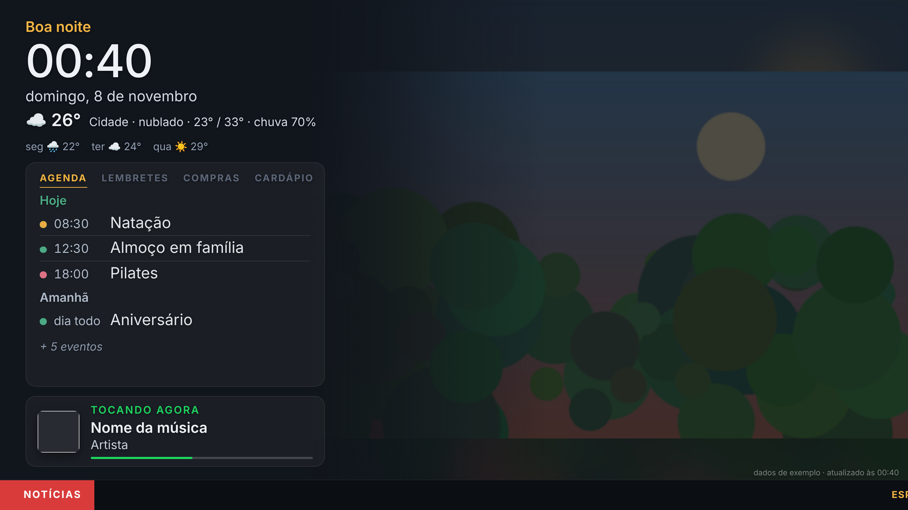

# homedash · Painel da Família

Um painel para TV com relógio, tempo, agenda e cardápio do dia, versículo e evangelho do dia, filmes em cartaz e fotos.
Cada pessoa pode ter o seu painel (`pessoa=pessoa1`, `pessoa2`...) e há um painel geral (`pessoa=familia`).



## Estrutura

| Pasta | O que tem |
|---|---|
| `web/` | O painel (`index.html`) e a tela de manutenção do carro (`carro.html`). Abra no navegador para ver com dados de exemplo. Publicado no GitHub Pages a cada mudança na `main`. |
| `apps-script/` | O script do Google Apps Script (`Code.gs` + `appsscript.json`) que lê agenda, cardápio (planilha) e fotos. |
| `android/` | App Android TV em Kotlin: um WebView em tela cheia que abre o painel ao ligar a TV. |
| `scripts/` | `manter-painel-chromecast.sh`: mantém o painel num Chromecast sem Google TV a partir de um celular Android com Termux. |

## 1. Planilha do cardápio (opcional)

Crie uma planilha no Google Sheets e compartilhe com quem mora com você para todos editarem pelo celular. Ela precisa de uma aba chamada **Cardápio**, com a primeira linha de títulos:

| Aba | Colunas |
|---|---|
| Cardápio | Dia (seg, ter, qua, qui, sex, sáb, dom) · Almoço · Jantar |

Sem planilha (`SHEET_ID` vazio), o painel fica sem o card Cardápio de hoje.

## 2. Script (Google Apps Script)

1. Acesse https://script.google.com, crie um projeto e cole o conteúdo de `apps-script/Code.gs`.
2. No topo do arquivo, preencha `TOKEN` (uma senha aleatória), `SHEET_ID` e os `PROFILES`:
   - **Perfis:** troque `pessoa1`, `pessoa2`... e os nomes pelos da sua casa apenas na sua cópia do script, nunca no repositório.
   - **Agendas:** as agendas das outras pessoas precisam estar compartilhadas com a sua conta. Coloque o e-mail/ID de cada uma em `calendars`.
   - **Fotos:** no Google Fotos, abra o álbum, toque em Compartilhar > Criar link e cole o link em `photos.album`. Se o link parar de funcionar, use uma pasta do Drive em `photos.folder`.
3. Rode a função `teste` uma vez para autorizar e conferir o resultado no log.
4. **Implantar > Nova implantação > App da Web**, executar como "Eu", acesso "Qualquer pessoa". Copie a URL que termina em `/exec`.

## 3. Publicar o painel (GitHub Pages)

O workflow `.github/workflows/pages.yml` publica a pasta `web/` a cada mudança na `main`. Para ativar, em **Settings > Pages**, escolha **Source: GitHub Actions**. Em repositório privado, o GitHub Pages exige o plano GitHub Pro.

O endereço do painel fica assim (o app Android monta isso sozinho):

```
https://dibmartins.github.io/homedash/?pessoa=familia&api=URL_DO_EXEC&token=SEU_TOKEN&lat=LATITUDE&lon=LONGITUDE&cidade=SUA_CIDADE
```

Sem `lat` e `lon`, o quadro do tempo não aparece.

## 4. App Android TV (TVs e sticks com Android TV / Google TV)

O workflow `.github/workflows/android.yml` gera o APK a cada mudança em `android/`. Na `main`, ele também publica o arquivo na release **app-mais-recente**.

**Instalar:**
1. Na TV, instale o app **Downloader** (by AFTVnews) pela Play Store e permita que ele instale apps (Configurações > Segurança > Fontes desconhecidas).
2. Abra o link do APK da release (ou copie o `painel-da-familia.apk` para um pen drive) e instale.
3. Abra o **Painel da Família**. Na primeira vez aparece a configuração. O jeito mais fácil: no celular, copie o endereço completo do painel (o mesmo que você usa no navegador, com `pessoa`, `api`, `token` etc.), abra o app **Google TV**, toque no teclado do controle virtual e cole no primeiro campo. O app preenche o resto sozinho; é só conferir e salvar.
4. Marque "Abrir o painel quando a TV ligar". No Android 10 ou mais novo, o app pede a permissão "Sobrepor a outros apps", necessária para abrir sozinho. Se a TV não mostrar essa tela, ative pelo computador: `adb shell appops set br.com.homedash SYSTEM_ALERT_WINDOW allow`.

**No controle:** as setas para os lados trocam de perfil (família, pessoa 1, 2, 3) e a escolha fica salva. Toque curto no OK recarrega o painel. Segure o OK (ou aperte MENU) para voltar à configuração.

**Assinatura:** para que cada versão nova instale por cima da anterior, cadastre os segredos `HOMEDASH_KEYSTORE_BASE64`, `HOMEDASH_KEYSTORE_PASSWORD`, `HOMEDASH_KEY_ALIAS` e `HOMEDASH_KEY_PASSWORD` em **Settings > Secrets and variables > Actions**. Sem eles, o APK sai com a chave de debug.

**Alternativa sem app:** o **Fully Kiosk Browser** (Play Store) também funciona: cole o endereço do painel em Web Content e ative "Start on Boot" e "Keep Screen On".

## 5. Chromecast sem Google TV (modelos antigos)

Esse modelo só exibe o que é enviado a ele. Há dois caminhos:

**Recomendado: um celular Android antigo como "controle" sempre ligado**

O celular fica na tomada, no Wi-Fi de casa, e a cada 5 minutos confere o Chromecast. Se ele estiver parado (nas fotos de fundo), envia o painel. Se alguém estiver vendo YouTube, não interrompe. À noite não envia nada.

1. No celular, instale o **F-Droid** (f-droid.org) e, por ele, o **Termux** e o **Termux:Boot**. A versão do Termux da Play Store está desatualizada.
2. Abra o Termux:Boot uma vez (para ele ser ativado).
3. Nas configurações do Android, tire o Termux da otimização de bateria (Apps > Termux > Bateria > Sem restrições).
4. No Termux, rode:
   ```
   pkg update && pkg install python cronie termux-api
   pip install catt
   ```
5. Copie o `scripts/manter-painel-chromecast.sh` para o celular, edite o IP do Chromecast e a URL do painel, e instale:
   ```
   mkdir -p ~/bin ~/.termux/boot
   cp manter-painel-chromecast.sh ~/bin/ && chmod +x ~/bin/manter-painel-chromecast.sh
   (crontab -l 2>/dev/null; echo "*/5 * * * * ~/bin/manter-painel-chromecast.sh") | crontab -
   printf '#!/data/data/com.termux/files/usr/bin/sh\ntermux-wake-lock\ncrond\n' > ~/.termux/boot/start.sh
   chmod +x ~/.termux/boot/start.sh
   ```
6. Reinicie o celular. Teste rodando `~/bin/manter-painel-chromecast.sh` com a TV parada nas fotos.

Dica: reserve um IP fixo para o Chromecast nas configurações do roteador, senão o IP pode mudar e o script deixa de encontrá-lo.

**Alternativa em um computador ou Raspberry Pi:** de um computador ou Raspberry Pi na mesma rede, instale o `catt` (`pip install catt`) e rode:

```
catt -d "NOME_DO_CHROMECAST" cast_site "URL_DO_PAINEL"
```

Para manter sempre ligado, agende esse comando a cada 15 minutos (cron) em um aparelho que fique ligado.

**B. App receptor próprio:** cadastre-se no Google Cast SDK Developer Console (taxa única de US$ 5), crie um "Custom Receiver" com a URL do painel e registre o número de série do Chromecast para teste. O painel já detecta que está num Chromecast e desliga o tempo limite de inatividade.

Se alguém transmitir YouTube ou outra coisa, o painel sai e volta no próximo envio.

**Modo leve.** No Chromecast (ou com `&leve=1` no endereço), o painel economiza memória, porque o modelo antigo tem só 512 MB e reinicia quando ela acaba. As fotos trocam sem esmaecer e sem a cópia desfocada nas laterais, não há sombras, a barra de notícias mostra uma manchete por vez em vez de rolar, e a página se recarrega sozinha a cada hora.

## 6. Spotify: "Tocando agora" (opcional)

Mostra a capa, a música e o artista do que está tocando na sua conta do Spotify, em qualquer aparelho. Desde fevereiro de 2026, o Spotify exige que o dono do app de desenvolvedor tenha **Premium**.

1. Em [developer.spotify.com/dashboard](https://developer.spotify.com/dashboard), clique em **Create app**. Escolha qualquer nome, marque **Web API** e, em **Redirect URI**, cole exatamente o endereço `/exec` do seu script.
2. Abra o app criado, vá em **Settings** e copie o **Client ID** e o **Client secret**.
3. No Apps Script, em **Configurações do projeto > Propriedades do script**, crie `SPOTIFY_CLIENT_ID` e `SPOTIFY_CLIENT_SECRET` com esses valores. Não coloque esses valores no código.
4. Publique uma nova versão do script (Implantar > Gerenciar implantações > lápis > Nova versão).
5. No navegador, abra `URL_DO_EXEC?token=SEU_TOKEN&spotify=login` e clique em **Autorizar o Spotify**. Ao final, aparece "Spotify conectado".
6. O card aparece nos perfis com `spotify: true`. Ele só é exibido enquanto algo toca, ou por 10 minutos depois de pausar.

## 7. Barra de notícias (opcional)

No perfil, preencha `news` com os sites, por exemplo `news: ['g1.globo.com', { site: 'https://site.com/feed/', name: 'Site' }]`. O script usa o feed RSS que o site anuncia e, se não achar, as manchetes do site no Google Notícias. As manchetes passam no rodapé, misturadas em ordem aleatória, e são atualizadas a cada 30 minutos. Com `news` vazio, a barra não aparece.

## 8. Lembrete do lixo (opcional)

No perfil, preencha `lixo` com os dias e a hora da coleta, por exemplo `lixo: { dias: ['segunda', 'sexta'], hora: '07:30' }`. Na véspera, a partir das 17h, aparece um aviso acima do card ("Amanhã cedo tem coleta de lixo"); no dia da coleta, da meia-noite até 30 minutos depois da hora, o aviso fica em destaque. Para mudar esses horários, use `vespera: '18:00'` e `ate: '08:30'`. Depois de mudar o script, publique uma nova versão.

## 9. Versículo e evangelho do dia

Na base da foto aparece um versículo da Bíblia por dia, o mesmo em todos os perfis. Ele troca à meia-noite. A lista fica em `web/versiculos.js`, em traduções de domínio público. Para acrescentar um versículo, inclua uma linha `["texto", "referência"]`.

O evangelho do dia vem de um serviço gratuito de liturgia diária ([liturgia-diaria](https://github.com/Dancrf/liturgia-diaria)). O script busca o texto e guarda por 6 horas. O card do evangelho reveza com a agenda e o cardápio a cada foto nova, e a letra diminui até o texto inteiro caber. Para conferir, execute `testeEvangelho` no editor do Apps Script. Para desligar o evangelho, deixe `GOSPEL_API` vazio. Se o serviço estiver fora do ar, o card não aparece e o resto do painel continua normal.

## 10. Filmes em cartaz (opcional)

O painel pode mostrar a programação de um cinema: cartaz, gênero, duração, classificação e os horários de cada filme, com a próxima sessão em destaque. A tela de filmes entra no lugar de uma foto, a cada 3 fotos, e fica 45 segundos. Ela mostra as sessões que ainda vão acontecer hoje; depois da última sessão do dia, mostra as de amanhã.

A programação vem do [AdoroCinema](https://www.adorocinema.com/). Procure o cinema lá e abra a página de programação. O endereço termina com `cinema-XXXXX/`. No começo do script, preencha `CINEMA` com esse código e o texto que aparece ao lado de "Em cartaz", por exemplo `const CINEMA = { code: 'XXXXX', name: 'No Cinema do Centro' };`. Os cartazes aparecem até 8 por vez; com mais filmes, a tela alterna as páginas. Para tirar os filmes de um perfil, coloque `cinema: false` nele; para desligar numa TV, use `?cinema=0` no endereço do painel.

O script guarda a programação por 3 horas. Para conferir, execute `testeCinema` no editor do Apps Script. Se o site estiver fora do ar, a tela de filmes não aparece e o resto do painel continua normal.

## 11. Manutenção do carro (opcional)

A página `carro.html` é uma tela à parte para acompanhar as revisões do carro: fundo preto, cards para o que precisa de atenção, barras de saúde (verde, amarelo, vermelho) para cada item e um carro 3D girando devagar. O carro é um modelo estilizado feito em código (`carro3d.js`), sem arquivo 3D externo. Abra `carro.html` no navegador para ver com dados de exemplo.

Os dados ficam em duas abas da mesma planilha do cardápio:

| Aba | Colunas |
|---|---|
| Carro | Campo · Valor. Campos: Nome, Versão, Data da compra, Km atual, Data do km, Km por mês (opcional), Cor (opcional, ex.: `#eef1f4`) |
| Manutenção | Item · Grupo · Data da última troca · Km na última troca · Trocar a cada (km) · Trocar a cada (meses) · Situação · Observação |

A saúde de um item é quanto ainda resta do intervalo de troca, em km ou em meses (o que acabar primeiro). O km de hoje é estimado pela média de uso, a partir da leitura mais recente (a da aba Carro ou a da última troca registrada). Itens sem data nem km contam desde a compra. Em **Situação**, `trocar` deixa o item vermelho (por exemplo, um desgaste apontado pela oficina) e `sem registro` deixa o item cinza até você informar a data. A **Observação** aparece em amarelo no card.

Para mostrar na TV, use o endereço `.../carro.html?api=URL_DO_SCRIPT&token=SEU_TOKEN`. No app Android TV, a tela do carro aparece junto com os perfis: use as setas ◀ ▶ do controle até ver "Carro" (ou escolha "Carro" nos ajustes). Use `?giro=0` para deixar o carro parado e `?3d=0` para tirar o carro 3D. No Chromecast antigo, o 3D fica desligado para poupar memória. Para conferir os dados, execute `testeCarro` no editor do Apps Script.

## Fotos e vídeos do álbum

As fotos aparecem inteiras, sem cortes, pedidas ao Google no tamanho exato da área da foto; nas laterais fica a mesma foto desfocada. Uma foto em pé sozinha aparece 15% maior, com um pequeno corte em cima e embaixo. Para a foto preencher a tela toda (cortando as bordas), acrescente `&fundo=cobrir` ao endereço do painel.

Fotos em pé aparecem em dupla, como duas Polaroids lado a lado, com o mês e o ano embaixo quando o álbum informa a data. Depois de atualizar o script, publique uma nova versão; a função `testeVideos` mostra no registro quantas fotos em pé e com data ele encontrou.

**Álbum inteiro.** A página de um álbum compartilhado só mostra as fotos mais recentes. Por isso o script lê o álbum todo, página por página, e a cada 6 horas manda ao painel um sorteio de 300 fotos de todas as épocas. Num álbum grande, a primeira leitura leva alguns minutos, e ela acontece aos poucos, a cada atualização do painel. Para ler tudo de uma vez e manter o índice em dia de hora em hora, execute uma vez a função `instalarAtualizacaoAlbum` no editor. A função `testeAlbum` mostra quantas fotos o álbum tem e de que datas. Fotos com menos de 800 pixels no lado maior ficam de fora, porque aparecem serrilhadas na TV.

Os vídeos são baixados por inteiro (na versão 1080p do Google Fotos, quando existe) enquanto o item anterior está na tela, e só aparecem quando estão prontos, para não travar.

Os vídeos do álbum tocam sozinhos, sem som, no fundo (no app de Android TV, pelo player do próprio Android, que é mais leve), e a próxima foto entra quando o vídeo acaba (no máximo 2 minutos por vídeo). No Chromecast sem Google TV, que é mais fraco, os vídeos ficam de fora.

## Segurança

- **A página do painel não guarda nenhum segredo.** O token vai só no endereço que você configura em cada TV. Não coloque o token no repositório.
- **O script só lê dados.** O arquivo `appsscript.json` limita as permissões a ler agenda e Drive. A planilha exige a permissão completa de Planilhas (o `SpreadsheetApp.openById` não aceita a somente leitura), mas o código apenas lê a planilha configurada. Ele não tem permissão para enviar e-mail nem mexer na sua senha. Para usá-lo, no editor do Apps Script ative "Mostrar o arquivo de manifesto appsscript.json" (Configurações do projeto) e cole o conteúdo.
- **Quem tiver o endereço `/exec` e o token consegue ver o que aparece no painel**, e nada além disso. Use um token longo e aleatório (o script recusa tokens com menos de 24 caracteres). Se desconfiar de vazamento, troque o `TOKEN` e implante de novo.
- **Eventos marcados como "Particular"** no Google Agenda aparecem só como "Ocupado".
- **Fotos do Drive:** o script só entrega fotos das pastas configuradas, nunca outros arquivos.
- Ative a verificação em duas etapas na conta Google, se ainda não estiver ativa.
